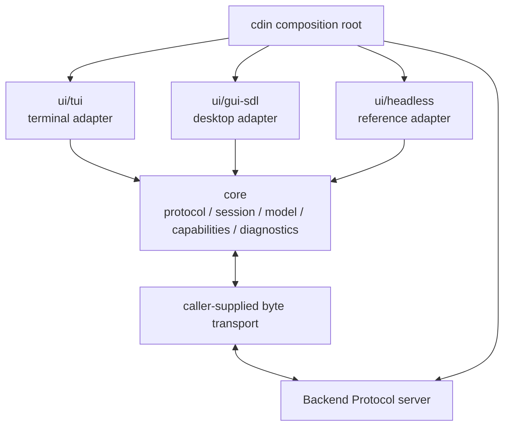

# Module boundaries

This document defines allowed source and link dependencies inside
`cdin-editor/frontend`. Cross-project rules remain governed by Spec ARCH-040..046
and FE-001, FE-002, FE-010, FE-012 and FE-014.

## 1. Dependency direction

The arrows from adapters to Core are public Frontend-owned C APIs. The
composition root chooses and assembles them. The Backend is a peer across a
protocol boundary; it is not a linked dependency of Core.

## 2. Allowed dependency matrix

| From | May depend on | Must not depend on |
| --- | --- | --- |
| `core/protocol` | C11 standard library, Core diagnostics | SDL, terminal APIs, font libraries, Backend/Runtime/Kernel headers |
| `core/session` | Core protocol public API, Core diagnostics | UI adapters, Backend session internals, Runtime or Kernel |
| `core/model` | Core protocol value types, C11 | Runtime tables, document-engine internals, pixels/cells/glyph metrics |
| `core/capabilities` | Core Protocol value types | UI-specific implementation details or implicit capability activation |
| `core/input` | C11 fixed-size/value types | SDL keycodes, terminal escape sequences, Runtime keymaps |
| `core/diagnostics` | `m-mdy-m/log.c` public API | Kernel logger or Backend logging internals |
| `ui/tui` | Core public headers, POSIX/Windows terminal APIs | SDL, GUI headers, Backend/Runtime/Kernel private headers |
| `ui/gui-sdl` | Core public headers, SDL3 and its chosen font/text dependencies | TUI headers, Backend/Runtime/Kernel private headers |
| `ui/headless` | Core public headers and test/runtime C11 | terminal, SDL, font libraries, Backend-private headers |
| `cdin` composition root | Public interfaces of all components | N/A; it is the build-time composition boundary |

`core` must remain buildable with all adapters disabled. A TUI-only build
must not require SDL3. A GUI-only build must not require terminal headers or
libraries. A Headless build must not require a display server, terminal device
or font stack.

## 3. Core is non-presentation infrastructure

Core owns:

- deterministic-CBOR frame encoding/decoding and payload schema validation;
- the per-connection Protocol client and sequence checks;
- handshake, attach/detach, driver/observer and flush-ACK state;
- semantic snapshot staging and protocol-level revision/version metadata;
- the central capability registry and negotiated capability set;
- toolkit-neutral values for `input.key`, `input.text`, `input.mouse`,
  `input.paste`, resize and focus;
- a thin Frontend-owned diagnostics facade.

Core does **not** own:

- terminal or SDL input parsers;
- visual layout algorithms or pane-to-rectangle/cell conversion;
- text shaping, bidi, grapheme-to-glyph mapping or display width;
- common render commands or GUI/TUI widget renderers;
- filesystem access, process creation, network socket creation or Runtime
  callbacks.

This restriction is deliberate. FE-012 says GUI and TUI share only semantic
Protocol and reusable non-presentation contracts; their renderers and layout
remain adapter-owned. FE-018 makes the complete byte-to-visual text mapping a
Frontend responsibility, not a Kernel or Runtime responsibility.

## 4. Adapter ownership

### TUI

`ui/tui` owns terminal readiness, raw mode, saved terminal state, escape/UTF-8
input parsing, terminal resize, cell layout, tab expansion, grapheme/cell
mapping, any terminal-specific bidi strategy, output buffering and terminal
rendering. POSIX and Windows APIs remain under `ui/tui/src/platform/`.

### GUI-SDL

`ui/gui-sdl` owns SDL3 initialization and teardown, window and renderer
resources, OS event translation, mouse/IME/clipboard adaptation, pixel layout,
font fallback, shaping, bidi, glyph cache and drawing. SDL headers and calls
must not leak into Core or other adapters (FE-020).

### Headless

`ui/headless` owns deterministic test scripts, frame recording/replay and
assertion output. It has no display dependency and is the reference adapter for
Protocol behavior (FE-007).

## 5. Public header rules

- Core public headers live under `include/cdin/frontend/core/`.
- Adapter-specific public headers live under that adapter's
  `include/cdin/frontend/ui/<adapter>/` tree.
- A Core header must not include a UI adapter header.
- TUI and GUI public APIs must not expose one another's types.
- Borrowed payload slices and render-frame pointers must document exact
  lifetime and invalidation rules.
- New public structs require explicit size/version evolution rules before
  being installed as stable APIs.

## 6. Static enforcement

`scripts/check-boundaries.sh` is the source-level guard. Extend it as each
adapter arrives. It must reject:

- `SDL_*`, `SDL.h` and `SDL3/` outside `ui/gui-sdl/`;
- `termios.h`, `poll.h`, `windows.h`, console APIs and terminal escape output
  outside `ui/tui/` and its tests;
- references from any Frontend source/header to Backend, Runtime or Kernel
  private include paths, symbol prefixes or linked targets;
- TUI-to-GUI, GUI-to-TUI, or adapter-to-Headless implementation dependencies;
- new rendering/text-layout code under `core/`.

The checker is a guardrail, not proof of runtime behavior. Unit and integration
tests remain required.
