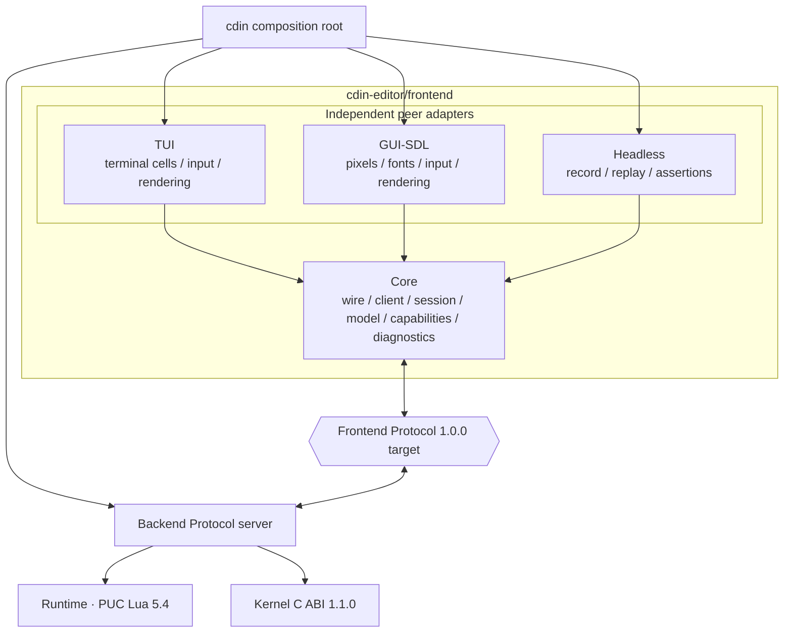

# Frontend architecture overview

**Authority:** CDIN Spec 1.2.0, especially FE-001..FE-023, ADR-0005,
ADR-0006, ADR-0011, ADR-0018 and ADR-0020. This document describes the
Frontend implementation boundary; it does not change the cross-project Spec.

## 1. Purpose

The Frontend is a family of independent clients for the Backend's semantic
Frontend Protocol. Each adapter converts its environment into Protocol input
messages and turns committed semantic UI updates into environment-specific
presentation.

A frontend may be restarted, replaced or detached without losing canonical
editor state. Any local line, layout, glyph, pixel or cell cache is derived and
disposable. The Frontend never owns document content, undo history, selections,
commands, keymaps, modes or file persistence.

## 2. Target topology



The diagram is the accepted target. Foundation Core API 1.0.0 now has a stable
UI-neutral package boundary. Both Frontend and Backend source snapshots now implement Protocol 1.0.0.
Their local codec suites pass the targeted shared-schema regressions; the complete
Spec-owned vector corpus, Runtime patch, real transport and live product E2E
remain release gates.

## 3. Component responsibility

| Area | Owns | Explicitly does not own |
| --- | --- | --- |
| `core/protocol` | Independent deterministic-CBOR codec, schema validation, framing and byte-stream client | Sockets, event loops, Runtime objects, Kernel API |
| `core/session` | Hello/attach/detach lifecycle, negotiated version, client ID, driver role and flush ACK tracking | Backend session management or editor policy |
| `core/model` | Protocol-level snapshot staging, model revision, view identity and document-version metadata | Canonical bytes, selections, visual geometry or persistent state |
| `core/capabilities` | Registered capability metadata and requested/accepted capability state | Claiming support that the concrete adapter does not implement |
| `core/input` | Small toolkit-neutral Protocol input value types | SDL event decoding, terminal escape decoding or keymap interpretation |
| `core/diagnostics` | Frontend-owned logger facade | Kernel logger, Backend logger or process-global hidden logger |
| `ui/tui` | Terminal lifecycle, terminal input, cell layout, text presentation and terminal renderer | SDL, Backend internals, commands, keymaps or document ownership |
| `ui/gui-sdl` | SDL lifecycle, desktop input, pixel layout, font/shaping path and GUI renderer | TUI internals, Backend internals, commands, keymaps or document ownership |
| `ui/headless` | Message recording, deterministic input replay and conformance assertions | Display, editor policy or persistent document state |

Core is intentionally smaller than a UI framework. It must not grow a common
renderer, common text layout engine, common bidi/shaping pipeline, pixel/cell
geometry layer, or platform abstraction that belongs to one adapter. The GUI
and TUI share semantic inputs and non-rendering Protocol/session utilities,
not presentation implementations (FE-012).

## 4. Ownership model

| State | Authority | Frontend representation |
| --- | --- | --- |
| Document bytes and version | Kernel, via Backend/Runtime | Version-pinned visible line bytes only; disposable |
| Selections and logical view position | Runtime UI model | Rendered projection; frontend sends visual movement as logical byte positions |
| Commands, keymaps and modes | Runtime | Raw key/text events sent to Backend; labels displayed as supplied |
| Logical pane tree and panels | Runtime semantic model | Adapter-specific pixel/cell arrangement |
| Theme and semantic style roles | Runtime/Backend model | Local palette, font and terminal-style mapping |
| Window/terminal handle and input state | Concrete UI adapter | Private adapter state |
| Physical text layout, shaping, bidi and wrapping | Concrete UI adapter | Disposable line and glyph layout caches |
| Session, transport endpoint and process | Backend / `cdin` composition root | Frontend client state and caller-supplied I/O callbacks |

A Frontend MUST NOT turn its visible line cache into an independent canonical
document store. All document-related cache entries are scoped by `view_id` and
`document_version` and are discarded when invalidated or superseded.

## 5. Source layout

```text
frontend/
├── core/src/
│   ├── diagnostics/       # logger facade
│   ├── protocol/          # CBOR, frame, client
│   ├── session/           # handshake, role and ACK state
│   ├── model/             # protocol snapshot/version state
│   ├── capabilities/      # stable registry and requested/accepted negotiation
│   └── input/             # protocol-level input value types
├── include/cdin/frontend/core/
├── ui/
│   ├── headless/          # reference recorder/replayer
│   ├── tui/               # input, platform, model, layout, text, render, session
│   └── gui-sdl/           # input, platform, layout, text, render, session
├── tests/
│   ├── core/{unit,integration}/
│   ├── conformance/
│   ├── ui/{tui,gui_sdl,headless}/
│   └── e2e/
└── docs/
```

The current source has `core/protocol`, `core/session`, `core/model`,
`core/input`, diagnostics, the registered capability set and requested/accepted
capability validation, plus the first TUI modules. The `gui-sdl` and `headless`
implementations remain planned areas. Foundation 1.0.0 installs Core only; TUI
is a buildable development preview and is deliberately excluded from the
stable installed package.
`core/layout` and `core/text` are deliberately not shared presentation modules;
visual layout and text presentation stay inside each peer adapter.

## 6. Runtime behavior at a glance

```text
physical input
    -> adapter input parser
    -> typed Protocol message
    -> Core client/session
    -> composition-root transport
    -> Backend Protocol server
    -> Runtime policy and Kernel-backed document operations

Backend message frames
    -> Core framing/validation/client sequencing
    -> adapter stages semantic messages
    -> ui.flush validates and commits one group
    -> ACK committed flush sequence
    -> adapter-specific layout/text/render
```

The Frontend does not invoke Runtime callbacks. All Runtime work occurs in the
Backend on its owner thread (ADR-0019). A frontend event loop only waits for
its device and transport readiness, sends/receives Protocol data, updates its
local presentation model, and draws.

## 7. Design invariants

1. All adapters use the same Protocol major/minor negotiation and conformance
   contract.
2. The Frontend codec is independent; it does not link the Backend's
   `cdin_protocol` target or Kernel.
3. Every message and flush sequence is checked per connection.
4. Only the driver sends editor-mutating input. Observers may ACK, request line
   ranges and answer capability-backed requests addressed to them.
5. No UI update becomes visible before a valid `ui.flush` commits it.
6. A `response` flush does not replace the semantic snapshot.
7. A stale line response is discarded; a new version is requested.
8. `input.key` and committed `input.text` are different events. Runtime owns
   keymap interpretation.
9. `units` on attach is `cells` or `pixels`; it is not a capability.
10. Every queue, cache, parser buffer and output batch has an explicit bound.
11. No adapter depends on another adapter or on Backend/Runtime/Kernel
    private implementation details.
12. The accepted TUI target uses a readiness-driven event loop and orderly
    terminal cleanup. This behavior is not yet implemented by the current TUI
    preview and remains a product-release gate.

## 8. Non-goals

The Frontend is not a generic application UI toolkit, not a command-line
interpreter, not a plugin runtime, not a document engine, not a file manager,
and not a persistence layer. The `cli` non-interactive client remains deferred.
Web/remote UI is not part of the initial delivery, although the serialized
Protocol keeps that direction possible.
