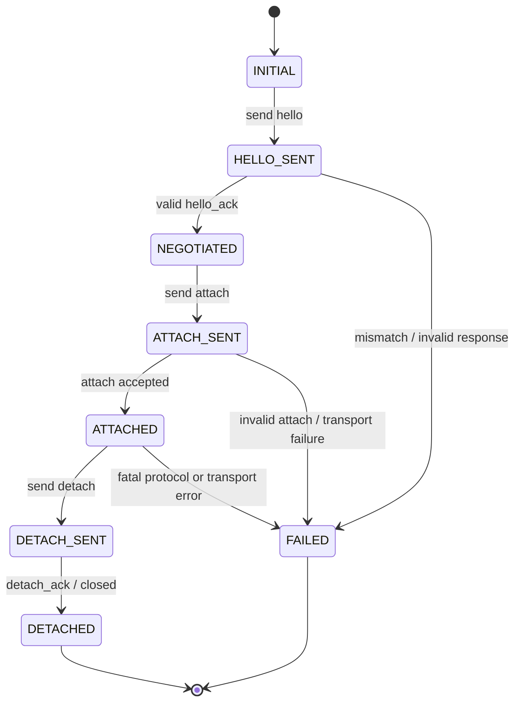

# Frontend Protocol contract and client behavior

**Authority:** [Spec protocol overview](https://github.com/cdin-editor/spec/blob/main/docs/architecture/frontend-protocol.md),
[normative wire contract](https://github.com/cdin-editor/spec/blob/main/docs/architecture/protocol-wire.md),
ADR-0018 and ADR-0020.

## 1. Version status

The UI-neutral Frontend Foundation C API is independently stable at `1.0.0`;
see [Core API 1.0.0](core-api.md). This does not change the wire version below.

| Layer | Version | Status |
| --- | --- | --- |
| Normative shared contract | `1.0.0` | Spec wire contract, mirrored by both source packages. |
| Frontend source codec/client | `1.0.0` | Implemented by the Frontend Core codec/client/session. |
| Backend source codec/server | `1.0.0` | Implemented by the Backend codec/server source snapshot. |

Protocol 1.0.0 is a breaking version freeze. Layout leaves require `active_view` with text-or-null semantics, and `ui.options` requires the typed `options` map. Both independent codec implementations, Backend projection, Frontend model validation, session negotiation and fixtures have been updated in the supplied source snapshots. Runtime application and transport-level conformance remain external integration gates.

## 2. What the Frontend implements

The Frontend contains its own Protocol codec/client. The Backend's reference
codec is a separate target and must not be linked from this repository. Both
implementations follow the same normative Spec schemas and conformance vectors.

The Frontend Core protocol layer is responsible for:

1. decoding and validating deterministic-CBOR envelopes;
2. validating known payload schemas and rejecting malformed required values;
3. preserving CBOR byte strings exactly;
4. validating frame length before allocation and respecting the negotiated
   frame limit;
5. maintaining envelope sequence numbers per connection;
6. enforcing message direction and driver-only message constraints;
7. exposing typed message views with documented borrowed-buffer lifetime;
8. reading and writing framed streams through the current blocking callback API.
   The client does not yet expose readiness-driven `PROGRESS`/`AGAIN` state or
   retain partial-frame offsets across event-loop turns.

## 3. Wire invariants

- Frame prefix: four-byte unsigned big-endian body length; the prefix is not
  included in the body length.
- One frame contains one CBOR envelope.
- Envelope keys are exactly `v`, `ns`, `seq`, `type` and `payload`.
- Protocol 1.0.0 uses `[1, 0]` for `v`, namespace `core` as mandatory, and
  unsigned monotonically increasing per-connection `seq` starting at 1.
- CBOR must use shortest-width integer/length encodings and definite-length
  items. Duplicate map keys, indefinite-length values, malformed UTF-8 text,
  trailing bytes, floats and unsupported simple values are rejected.
- Document and paste content is a CBOR byte string. It must never be coerced
  through UTF-8 text or NUL-terminated string handling.
- Default body limit is 1 MiB. A configured/local lower cap remains valid;
  no receiver may accept a frame above its negotiated/local cap.

The normative message schemas, nullable fields, payload bounds and exact
Protocol 1.0.0 behavior are defined in Spec `docs/architecture/protocol-wire.md`.
This repository must not fork the schema into an independently maintained
contract.

## 4. Connection lifecycle

Rules:

- `hello` is the first frame. No other message is valid before negotiation.
- The negotiated version must be in the client's advertised range and must be
  implemented by the local codec and adapter.
- `attach` is sent only after valid `hello_ack`; the client is not attached
  until the Backend accepts it.
- Client identity, session ID, driver role and accepted capabilities are
  copied from the handshake response and scoped to that connection.
- A failed or closed connection invalidates its pending requests and all
  presentation caches tied to that client.

## 5. Driver and observer roles

There is exactly one driver lease per session. The first attached client gets
it; the oldest remaining attached observer is promoted when the driver
explicitly detaches or closes. Only the driver may send:

- `input.key`, `input.text`, `input.mouse`, `input.paste`;
- `window.resize`, `focus`, `view.set_position`;
- `request.command`.

Observers may ACK a published flush, request visible line ranges and answer
capability-backed requests specifically addressed to them. A Frontend must not
send editor mutations while it is an observer, even if the local UI still has
focus. A driver promotion is reflected by connection/session state before the
next mutating event is emitted.

## 6. UI update handling

Messages are staged by flush group. No visible presentation state is changed
until a complete valid `ui.flush` is received.

- `scope="snapshot"`: complete replacement of semantic UI state at a newer
  model `revision`. Omitted prior views/panels are removed.
- `scope="response"`: request result or diagnostic; it does not clear or
  replace the current semantic snapshot.
- Flush-group `sequence`, envelope message `seq`, model `revision` and document
  `version` are distinct counters. Never compare or ACK one in place of
  another.
- ACK only after the whole group is validated and committed locally.
- On failure, do not ACK the failed group as if it were applied. Surface the
  error and follow the connection recovery policy.

Line data is pull-based. A request contains `view_id`, `first_line`,
`line_count` and expected document `version`. `view.lines` and
`view.invalidate` are versioned. A frontend discards stale line data and
re-requests only the visible range for the latest known version. The Kernel and
Backend remain authoritative for document bytes.

## 7. Input translation

- Physical key identity/action/modifiers are sent as `input.key`.
- Committed Unicode text, including completed IME composition, is sent as
  `input.text`.
- Paste is sent as `input.paste` byte data; the bytes are not silently
  normalized or rewritten.
- Resize and focus are sent as their own messages.
- Pointer input is emitted only when `mouse` is in the negotiated capability
  set and the adapter can provide a valid logical target/position.
- The Frontend translates physical devices and visual movement; it does not
  map keys to editor commands. Runtime owns keymaps and command semantics.

## 8. Protocol 1.0.0 conformance and remaining work

The Frontend wire codec, typed `ui.options.options` validation, nullable
`active_view`, exact 1.0.0 version negotiation and message direction checks are
implemented in this source snapshot. The paired Backend source archive also
implements Protocol 1.0.0; the paired Runtime archive reports Host API 1.0.0
and Protocol 1.0.0.

The following are still product-level gates rather than codec-version gaps:

1. Apply the complete Spec-owned positive/negative vector corpus to both peers.
2. Implement a full committed semantic model and atomic snapshot/response
   transaction, including PaneTree, panels, styles and the 32-view/16-panel
   bounds.
3. Add readiness-driven partial-progress I/O without changing the already
   stable Foundation Core 1.0.0 public structure layouts.
4. Verify the Runtime projection and event path against real Lua 5.4 and the
   real Kernel package, not only source-level or simulated-host tests.
5. Connect the composition-root transport and run live product E2E.

Do not downgrade or silently fall back to Protocol 0.2.0. A 1.0.0 package
version is not a substitute for shared conformance evidence.

## 9. External boundaries

The Frontend codec works on byte-stream callbacks. It does not create sockets,
listening ports, named pipes, authenticate peers, encrypt transport, or own
Backend readiness. The `cdin` composition root supplies the actual transport
and event-loop integration. See [Event loop and I/O](event-loop-and-io.md).
