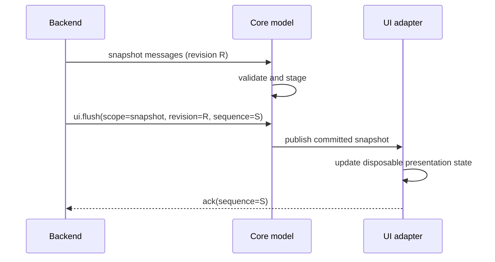

# Semantic UI model and presentation cache

**Authority:** Spec `docs/architecture/ui-model-v1.md` and Protocol 1.0.0
`docs/architecture/protocol-wire.md`. The Runtime owns semantic UI state; the
Frontend owns the environment-specific representation.

## 1. Model ownership

The Runtime publishes `cdin.ui-model.v1` snapshots through the Backend. The
Frontend receives only the Protocol projection of that model. It must not
interpret a Lua table, access Host objects, or store document bytes as
canonical state.

The model has a monotonically increasing `revision`; each view has a stable
ID, document identity metadata, document version/length, selection byte
positions, logical scroll anchor, visibility and view-local revision. The
model's `views` map may be empty. The root focus may be null. The layout may
have no root or active leaf.

The Spec limits one Runtime snapshot to at most **32 views** and **16 panels**.
The Frontend must validate those bounds before it allocates a committed model.
A cache capacity of 128 views in the current prototype is not permission to
accept a larger normative model.

## 2. Atomic flush groups

All messages between flush markers form one staged group:

A snapshot group replaces the previously committed snapshot, including
removing views and panels omitted from the new snapshot. A response group
carries a request result/diagnostic and must not clear or replace the snapshot.
If any message in a group is malformed or violates limits, the group is not
committed and is not ACKed as if it had been applied.

Track these counters independently:

| Counter | Meaning |
| --- | --- |
| Envelope `seq` | Every message on a connection. |
| Flush `sequence` | One atomic update group; value sent in `ack`. |
| Model `revision` | Semantic UI snapshot revision. |
| Document `version` | Canonical byte sequence revision for one document. |
| View `revision` | View-local semantic state revision. |

Comparing or acknowledging the wrong counter is a protocol bug.

## 3. Layout tree

Protocol `ui.layout` contains `root: map|null` and `active_leaf: text|null`.
A recursive node is one of:

- **Leaf:** `kind="leaf"`, stable `id`, `views` array and
  `active_view: text|null`. A non-null active view must be included in that
  leaf's `views` array. A null active view is valid and means the leaf has no
  active view.
- **Split:** `kind="split"`, stable `id`, axis `horizontal` or `vertical`,
  integer `ratio_bp` in `1000..8999`, and `first`/`second` child nodes.

The complete tree must be acyclic, node IDs unique, view references valid,
and each view placed according to the Spec's exact uniqueness rules. A null
root and null active leaf represent an empty layout. The Frontend validates
the semantic tree; each adapter separately maps it to cells or pixels.

Core may retain the validated semantic tree or an immutable protocol view of
it. Core must not compute rectangles, terminal cells, text wrapping or font
metrics. Those are private to the selected adapter.

## 4. Typed `ui.options`

Protocol 1.0.0 requires `ui.options` to contain `revision:uint`, `theme:text`
and `options:map`. The `options` map may be empty. Defined keys are:

| Key | Type | Constraint |
| --- | --- | --- |
| `title` | text | UTF-8 title string |
| `tab_width` | uint | `1..64` |
| `wrap` | bool | adapter text wrapping preference |
| `line_numbers` | bool | absolute line-number visibility |
| `relative_line_numbers` | bool | relative line-number preference |
| `cursor_shape` | text | `block`, `bar` or `underline` |
| `cursor_blink` | bool | adapter cursor blink preference |

Missing keys use adapter defaults. Defaults must be deterministic and
written down per adapter; they must not become Runtime policy. Unknown optional
keys follow Protocol 1.0.0 evolution rules. Wrong types or invalid recognized
values invalidate the message/group.

## 5. Style table and panels

`ui.style_table` maps semantic role IDs to style attributes. Role IDs are
portable semantic names/identifiers, not SDL colors or terminal escape
sequences. GUI maps roles to palette/font attributes; TUI maps them to the
terminal's available attributes; Headless records them exactly.

Panels are declarative state keyed by stable panel ID. Ordinary plugin UI uses
declarative widgets. Arbitrary plugin drawing is not assumed: `canvas` is an
optional capability and adapters without it must degrade gracefully or report
the surface unavailable.

The Frontend must support the Spec's bound of 16 panels. Unknown optional
widget fields are handled under the Protocol evolution rules; malformed
required widget structure must not produce a partial panel update.

## 6. Version-pinned line windows

Line content is delivered only in response to a visible-range request or an
explicit negotiated push capability. A line result carries `view_id`,
`document_version`, `first_line`, `lines` and optional `total_lines`.
Each line preserves original bytes. Style spans use byte offsets within the
line and semantic role IDs.

Rules:

1. Keep only bounded visible windows, not a second document buffer.
2. Bind cached lines to both `view_id` and exact `document_version`.
3. Reject a result older than the newest observed version for that view.
4. On invalidation, mark affected cache ranges stale and request the visible
   range at the latest known version.
5. Never splice bytes from different document versions into one visible line
   buffer.
6. A line response is applied only if its requested version and view identity
   still match the outstanding request.
7. Keep line and span count limits aligned with the Spec (`1..4096` lines per
   response and at most 4096 spans per line).

The UI adapter derives wrapping, tabs, display columns, bidi and glyphs from
these byte strings. It may cache those derived values but must drop them when
the line version, width, font, theme or relevant option changes.

## 7. Implementation checklist

- Replace the current one-view-only committed model with a bounded model that
  handles 32 views and 16 panels.
- Parse and validate the full pane tree, including nullable values.
- Implement complete typed `ui.options` parsing.
- Retain the committed style table and declarative panel model.
- Keep snapshot and response staging separate.
- ACK only after successful commit.
- Support multiple line requests per visible view with version identity.
- Add tests for null root, null active leaf, null `active_view`, empty options,
  panels removed by snapshots, stale line results and model-limit overflow.

## 8. Bounded Core semantic snapshot validator (implementation status)

`include/cdin/frontend/core/model/semantic.h` and
`core/src/model/semantic.c` now provide an allocation-free, bounded semantic
snapshot value type and validator. It enforces the normative 32-view,
16-panel and 63-layout-node bounds; stable unique IDs; valid view references;
leaf active-view membership; split axis/ratio constraints; selection and
scroll positions within document length; typed option ranges; unique panel
and style roles; and monotonic atomic snapshot replacement. The store copies a
new snapshot only after complete validation, so a rejected update leaves the
previous committed snapshot unchanged.

This is deliberately a semantic C value API, not a claim that inbound CBOR
`ui.*` messages are now projected into it. The message-to-snapshot projector,
declarative widget schema, multi-view request scheduling, and shared Protocol
fixtures remain separate integration work. Keeping parsing separate
prevents a partially decoded flush from mutating committed presentation state.

## 9. TUI line-request correlation (implemented for its active view)

The TUI viewport records the exact `view_id`, requested document `version`,
`first_line` and maximum `line_count` when it creates a visible-range request.
A `view.lines` response is accepted only while that request is outstanding,
with the same view/version/start line and no more lines than requested. Older
versions are ignored as stale; a future/unrequested version is rejected. A
successful response group clears the pending request only after atomic flush
commit. An invalid response group is not ACKed by the TUI adapter.

This closes the single-active-view correlation gap for the current TUI
preview. The semantic store and TUI viewport are not yet unified into a
multi-view adapter; concurrent outstanding requests across all visible views
remain pending.

Spec: [FE-005](https://github.com/cdin-editor/spec/blob/main/docs/components/frontend.md#L67),
[UI Model v1](https://github.com/cdin-editor/spec/blob/main/docs/architecture/ui-model-v1.md).
