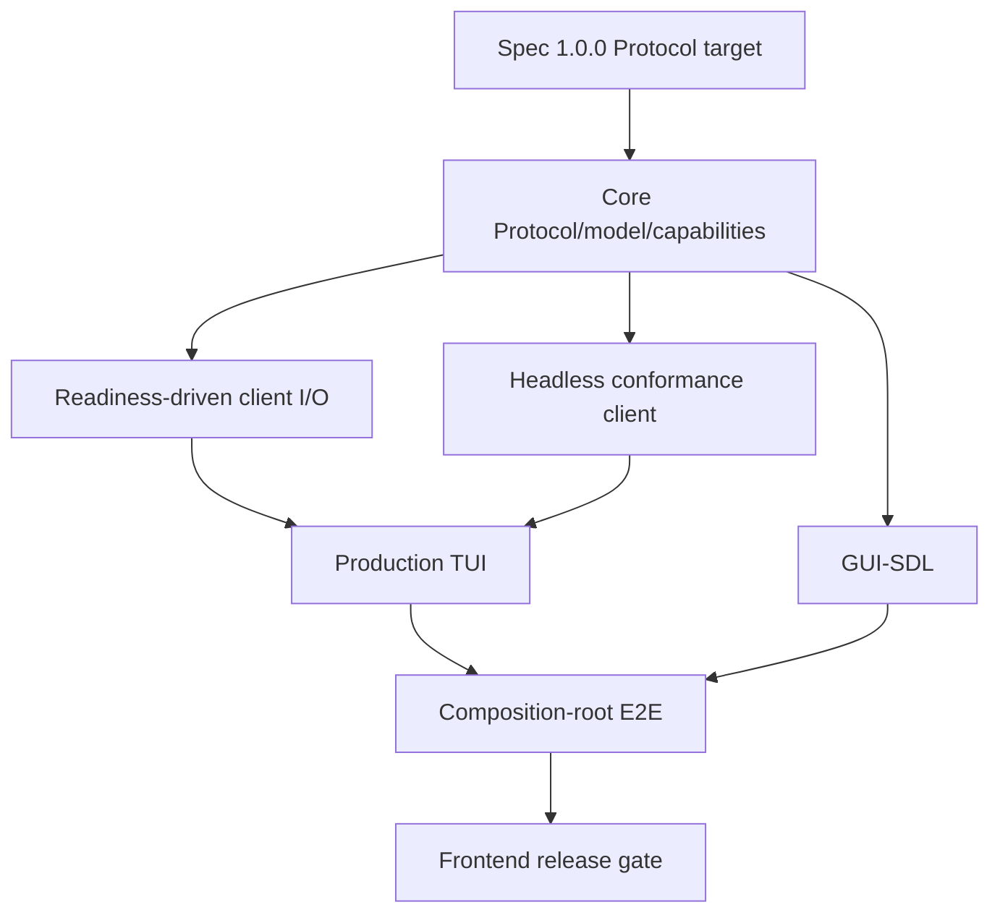

# Frontend implementation roadmap

This roadmap orders the remaining work by contract dependencies. It separates
what is already in the source from the next implementation gates. It does not
change the accepted Spec design or silently promote proposals to decisions.

## Track A — Protocol 1.0.0 and remaining Core integration

The UI-neutral Core package itself is released as Foundation 1.0.0. This track
continues the separate breaking wire-protocol migration and remaining Core I/O/model work.

| Work package | Deliverable | Exit condition |
| --- | --- | --- |
| A0: contract baseline | 1.0.0 schema inventory and mapping from every 0.2.0 handler | Every field, null and bound traces to Spec. |
| A1: codec upgrade | 1.0.0 envelope/payload validator and frame encode/decode | Same positive/negative vectors pass in Frontend and Backend. |
| A2: session and roles | negotiated version, driver state and ACK rules | Driver/observer and lifecycle tests pass. |
| A3: semantic model | 32 views, 16 panels, PaneTree, options, styles, snapshot/response groups | Null/empty/removal/stale cases pass. |
| A4: capability registry | Core registry and requested/accepted mask validation | Core registry is implemented in Foundation 1.0.0; adapter-specific masks and Protocol 1.0.0 vectors remain. |
| A5: readiness IO | partial progress, `AGAIN`, EOF/error and wait integration | No event loop busy-waits or blocks on full-frame reads. |

## Track B — Headless reference client

Build this early because it validates Core without a display and provides a
repeatable regression harness for TUI/GUI:

1. in-memory partial-I/O transport;
2. recorder of exact frames and flush boundaries;
3. deterministic input scripts and replay;
4. driver/observer, capability, sequence and model assertions;
5. shared Spec vectors and negative corpus;
6. bounded recording and fault injection.

**Exit:** Headless can reproduce a session transcript and detect an invalid
atomic update or stale-line result without TUI/GUI libraries.

## Track C — first production TUI

1. readiness-driven terminal/transport loop;
2. terminal restore and signal-safe shutdown on POSIX and Windows;
3. complete 1.0.0 snapshot model and one-view editing path;
4. Runtime-owned editing commands/keymaps and Backend transport integration;
5. full layout tree and declarative panels/styles;
6. grapheme/cell mapping, tabs, wrapping and documented Persian/RTL behavior;
7. optional capability implementations only when actually available.

**Exit:** A real file can be opened, edited, undone/redone, saved, reopened and
byte-compared through the entire product path.

## Track D — desktop GUI-SDL

1. approve/pin SDL3 and text/font dependency strategy;
2. implement SDL resource lifecycle and wait/event integration;
3. implement input and capability mapping;
4. implement pixel pane layout and line-cache lifecycle;
5. implement shaping, font fallback, bidi and hit testing;
6. implement rendering, styles, selection, widgets and dialogs;
7. run native platform matrix and live E2E.

**Exit:** GUI is an independent Protocol peer, not a private Backend window.

## Track E — product integration and release

`cdin` owns concrete transport construction, process lifecycle, component
startup/shutdown order and package composition. Backend owns its Protocol
server and Runtime host. Frontend adapters own only their device-side event
loop and rendering.

The release gate requires:

- Backend and Frontend both advertise Protocol 1.0.0 after shared conformance;
- Runtime Host API and UI model versions match the Backend build;
- a real composition-root transport passes handshake, input and UI update;
- no cross-component private include or link dependency;
- real logger dependency build (no test shim) passes;
- all supported OS adapters pass lifecycle tests;
- data-safety E2E preserves exact file bytes;
- documented capability support matches actual session behavior.

## Deferred work

- Non-interactive CLI (Spec FE-008).
- Web/remote/networked frontend.
- Universal terminal image/canvas support.
- Generalized plugin drawing outside the optional canvas capability.
- Any common rendering/text-layout engine shared by GUI and TUI.

## Dependency order

